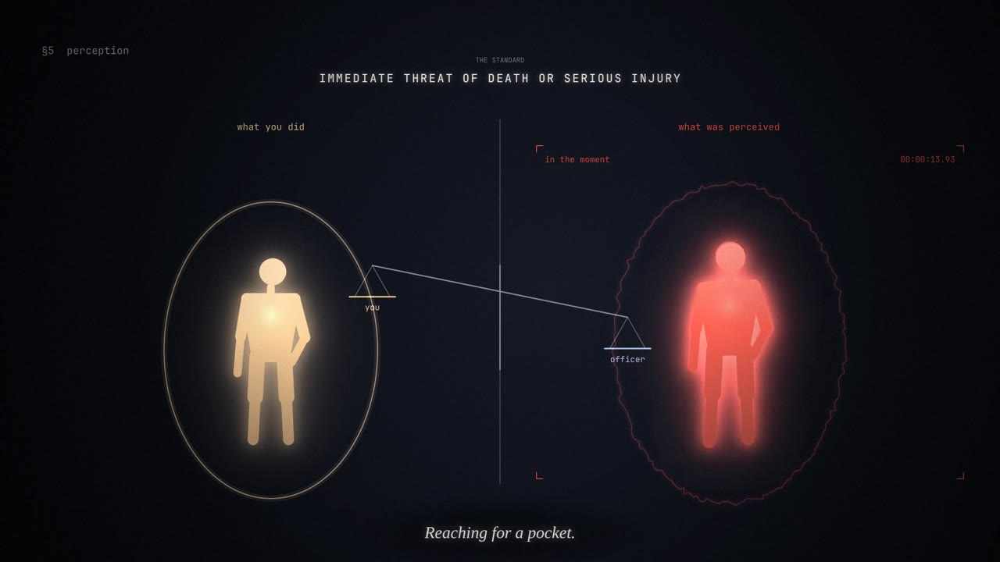

# Fine Print

*Your body belongs to you.\** 3:21, 1080p, narrated, with an original score.



▶ **Watch:** [`fine-print.mp4`](fine-print.mp4), or open [`index.html`](index.html) in a browser to play the live version (click to play/pause, drag to scrub; it plays `soundtrack.m4a` alongside when the file is next to it).

## The film

A body is a figure of light inside a soft boundary that is its own. Authority appears only as hands: rigid, geometric, coming in from off-screen. Each section adds a clause to a growing column of fine print, with one more asterisk each time.

- **Title.** *Your body belongs to you.* "In most circumstances." An asterisk appears.
- **§1 contact.** The hands grab, hold down, and cuff. Every "no" spreads outward and passes straight through them. *CHARGED: RESISTING ARREST.* The boundary hardens into a concrete cell: pretrial, day by day, bail unpaid; then months, then years, in tally marks faster than anyone could count.
- **§2 search.** A scan line. Pat-down markers, named as the narration names them. The boundary falls away under a cold light. *I do not consent.* **[noted].** Solitary. Then pinned at four points.
- **§3 misconduct.** The boundary cracks. Two hands, one tagged *LEGAL POWER*, one tagged *CRIME*, look the same from inside. A timeline: harm, now; accountability drifting off to the right, then a question mark.
- **§4 force.** A meter climbs with each refusal: commands, grab, control hold, takedown, held down, baton, Taser, pepper spray, with *deadly force* waiting at the top. Fractures. *And worse.*
- **§5 perception.** Split screen, *what you did* against *what was perceived*: the same small movements, marked THREAT, under the standard *immediate threat of death or serious injury* and a scale tipped toward the officer. Then one figure steps back from hands that were about to touch it. Freeze. The light dissolves.
- **Coda.** *Your body belongs to you.\** Beneath it, the original text that inspired the film, set as the fine print.

The narration follows the source text closely, including its hedges (*can*, *some*, *in most of these situations*), so the film claims no more than the text does. It is abstract throughout, with no gore and no depiction of a shooting.

## How it's made

- `index.html` is the film: a canvas animation where every frame is a pure function of time. The script at the top lists each narration line with its measured length; the whole timeline is built from those lengths, so picture and voice share one clock. The figure is a jointed rig posed by keyframes; hands attach to its joints and follow it; the boundary dents where fingertips press into it.
- `render.mjs` renders it headlessly with Playwright across four workers into x264, and exports the cue sheet.
- `voice.py` speaks the cue sheet with [Kokoro](https://github.com/thewh1teagle/kokoro-onnx) TTS: the narrator (`af_bella`), a different voice for each "no", and commands pushed through a hard, narrow band. It flags any line that overruns its slot.
- `audio.py` builds the score from the cues in numpy: cold drones per section, a heartbeat that speeds up under the force, and a sound for each contact (grips, cuffs, a cell door, tally scratches, a scan, cracks, the meter). It cuts to silence at the freeze and ducks the music under speech.
- `build.sh` runs it all and muxes the result.

```sh
pip install kokoro-onnx   # optional: without it the film builds without voices
./build.sh                # needs node + playwright (Chromium), python3 + numpy, ffmpeg
```
