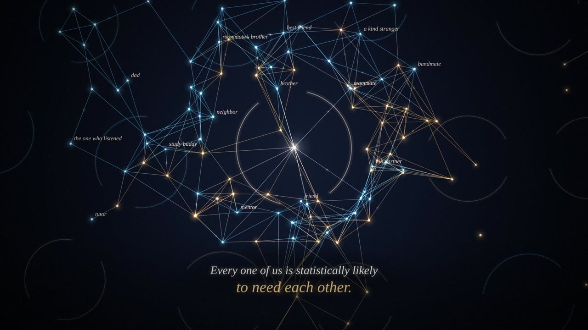

# Statistically Likely

*A short film about fear, love & arithmetic.* 2:28, 1080p, with an original synthesized score.



▶ **Watch:** [`statistically-likely.mp4`](statistically-likely.mp4), or open [`index.html`](index.html) in a browser to play the live version (click to play/pause, drag to scrub; it plays `soundtrack.m4a` alongside when the file is next to it).

## The film

People are points of light. Connections are threads between them.

1. **Arrival.** A first-year student drifts into a campus of strangers, amber and blue, and threads form the way they always have: by proximity, by accident, by courage.
2. **The advice.** A comment types itself out: *avoid men at all costs… reject anyone statistically likely to do you harm.* Every amber–blue thread snaps. A circle draws itself around her. Everyone outside it turns gray and becomes a number. Her old friends drift away; twice, one reaches back and hits the wall. *The fear is real. The harm is real. But a wall can't tell a threat from a friend.* Then the camera pulls back: a whole campus of safe little circles, and a generation wondering why it feels so alone.
3. **The mirror.** Things we say, and what their reflections say back when they turn around: *we want deep connection / and flinch when it's offered*, *love / and punish lovability*, *honesty / and fear the truth*. Finally *"Respect my privacy." / "What are you hiding?"*, the same person, same breath, colliding into static.
4. **The mob.** A man who loves his wife, his kids, and someone else. The internet, having met him zero times, arrives as a red swarm: *IT WAS ALL A LIE. NOBODY CAN LOVE TWO PEOPLE.* Freeze. Silence. Then a candle lights six others and stays at 100%, and those light ninety more. *A flame that lights another flame loses nothing. Love isn't a pie. It's a fire.* The hurt is real. So was the love. Both can be true.
5. **Doors.** Back to the campus of circles. *Keep the boundaries. Make them doors.* Gaps open in every ring, people walk through them, color comes back, the numbers resolve into words (*friend, brother, lab partner, a kind stranger*) and a web of every color forms around her. *Every one of us is statistically likely to need each other.*

## How it's made

- `index.html` is the whole film: a canvas animation in which every frame is a pure function of time. The only simulated part is the web of threads, which is computed once at load, so any frame can be drawn in any order.
- `render.mjs` renders it headlessly with Playwright, splits the frames across four workers, pipes PNG frames into ffmpeg/x264, and exports a cue list (every thread that forms or snaps, every flip, shout and ignition).
- `audio.py` synthesizes the score from those cues in numpy: pad chords that follow the acts, a chime for every new connection, a crack for every broken one, a heartbeat behind the wall, a crowd built from filtered noise and formant-shaped "shouts", and a hard cut to silence at the freeze.
- `build.sh` runs all three and muxes the result.

```sh
./build.sh   # needs node + playwright (Chromium), python3 + numpy, ffmpeg
```

Inspired by an anonymous Reddit comment and the conversation it started about fear, connection, and whether love is a scarce resource.
