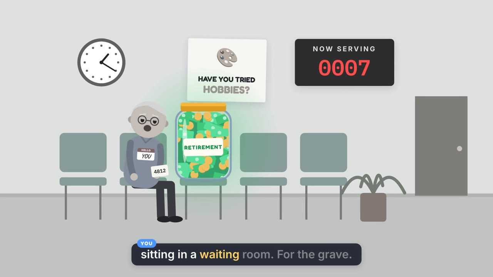

# THE PLAN™ — a helpful explainer (*results may vary)

A 2:49 animated explainer about the money-first life script and its
missing fine print. A cheerful piggy bank in a tie called **The System**
walks **You** through The Plan: make money, save for retirement, and
look for love, family, community and a village "on the side". Twenty
years of hobbies later, nobody can tell you how often that advice
actually works.

**Watch:** [`out/the-plan.mp4`](out/the-plan.mp4) (1920×1080, 30 fps, with captions burned in)



## Scenes

| time | scene | what happens |
|---|---|---|
| 0:00 | Title | SOCIETY™ ("Everything is fine.™") presents THE PLAN™. The System says hi. |
| 0:08 | Step 1: make money | Coins fly into a RETIREMENT jar that earns a #1 PRIORITY ribbon. Then the support network appears: calculators, advisors, employer match, tax breaks, quarterly statements. |
| 0:31 | Step 2 (optional): love | Love, family and community shrink into a "side quest" panel. Dating app, pottery club flyer, then the same support cards for love, all empty, around an empty jar with a cobweb. A bleep covers the swear. |
| 0:42 | Twenty years | Age 25 to 65. Savings climb, while the love tracker says "Searching… 0%". A hobby pile grows, then it rains hobbies ("HOBBIES, BRO!"). The world slowly loses its colour, except the money. |
| 1:13 | Waiting room | Old You in a waiting room next to an overflowing jar. NOW SERVING 0007, ticket 4812. "Have you tried hobbies?" poster. The System says goodbye and switches off the light. |
| 1:24 | Hold on | Two prospectuses. The retirement fund discloses its odds, returns, risk and fees. The plan for love has its numbers redacted: SUCCESS RATE NOT DISCLOSED. |
| 1:46 | 100 people | Guess: 50 find love, family and a village. One real number: the U.S. Surgeon General's 2023 advisory (about 1 in 2 U.S. adults report loneliness). The other 50 get money, food and a home. Still 50. |
| 2:24 | The pyramid | A needs pyramid. Food and a home are "covered by the plan", while love, esteem and meaning are "not included". Then they fall off. |
| 2:35 | The point | Money comes with a prospectus. Love comes with a sticky note. "If the advice really works, show us the success rate." |
| 2:45 | Sign-off | Bright corporate end card. "Thank you for choosing Life! Goodbye n—" (hard cut). |

## Change it

Everything is plain text. Edit, then rebuild (below).

- **Words**: [`script.json`](script.json) holds every line, who says it (`SYS` = The System,
  `YOU` = You), and the pause after it. `say` overrides how a line is pronounced
  without changing the caption.
- **Pictures**: [`src/scenes.js`](src/scenes.js) has one `scene({...})` block per scene.
  Timing is tied to the narration: `Ls('s04')` is when line `s04` starts, and `Wd('s04', 'priority')` is
  when that word is spoken. Changing the wording or the voice keeps the picture in sync.
- **Look**: colours, characters (`drawYou`, `drawPig`), captions and transitions are in
  [`src/engine.js`](src/engine.js).
- **Sound**: [`tools/audio.py`](tools/audio.py) synthesizes all music and effects from scratch: the jingle, its slow
  decay, the waiting-room muzak and tape stop, the piano pad, and the bleeps and stamps.
- **Bleeps and the final cut** are applied when mixing, so the cached `build/voice/s09.wav` is
  uncensored; `bleep.at` / `cut.at` in `script.json` say where they land.
- **Voices**: change `voice`/`speed` under `voices` in `script.json`. Some options are `af_heart`, `af_bella`, `am_michael`,
  `am_fenrir`, `bf_emma` and `bm_george`.

## Preview without rendering

Open [`index.html`](index.html) in a browser. It plays the animation live with the
soundtrack (`build/preview.mp3`). Keys:

- Space: play/pause
- ←/→: seek 2 s
- `,`/`.`: step one frame
- C: captions
- D: show line ids and timestamps, handy when editing `scenes.js`

## Rebuild

Requirements: Python 3.10+, Node 18+, ffmpeg, Chromium for Playwright.

```bash
pip install -r requirements.txt
npm install playwright && npx playwright install chromium   # skip if Playwright is already around
./make.sh            # narration -> cues -> soundtrack -> out/the-plan.mp4
./make.sh preview    # stop after the soundtrack (enough to refresh index.html)
./make.sh --to 30    # extra flags go to the video step, here just the first 30 s
```

The first run downloads the Kokoro TTS model (~350 MB) and Whisper `small.en`
into `~/.cache/the-plan-explainer` (override with `PLAN_MODEL_DIR`). Narration is
cached per line in `build/voice/`, so editing one line only re-voices that line.
After re-voicing, `tools/voice.py` checks every line with speech recognition
and lists any line that doesn't come back as written.

| step | command | output |
|---|---|---|
| narration | `python3 tools/voice.py` | `build/voice/*.wav`, `build/timeline.{json,js}` |
| sound cues | `node tools/render.mjs cues` | `build/cues.json` |
| soundtrack | `python3 tools/audio.py` | `build/mix.wav`, `build/preview.mp3` |
| video | `node tools/render.mjs video` | `out/the-plan.mp4` |
| stills | `node tools/render.mjs stills 12.5 80` | `build/stills/*.png` |

## Credits and sources

- Voices: [Kokoro-82M](https://huggingface.co/hexgrad/Kokoro-82M) (Apache-2.0) via
  [kokoro-onnx](https://github.com/thewh1teagle/kokoro-onnx). The System is `af_bella`, You is `am_michael`.
- Word timing: [faster-whisper](https://github.com/SYSTRAN/faster-whisper) `small.en`.
- Fonts: Fredoka, Inter, DM Serif Display, IBM Plex Mono and Caveat, all under the SIL Open Font License
  (see [`fonts/LICENSES.txt`](fonts/LICENSES.txt)). Emoji are from the system emoji font.
- Music and sound effects are synthesized in `tools/audio.py`, with no samples.
- The one real statistic: [Our Epidemic of Loneliness and Isolation](https://www.hhs.gov/sites/default/files/surgeon-general-social-connection-advisory.pdf),
  U.S. Surgeon General's Advisory (2023): about half of U.S. adults report experiencing loneliness.
  The "50 of 100" in the video is a guess, as the narration says. The retirement figures are labelled
  sample figures.
